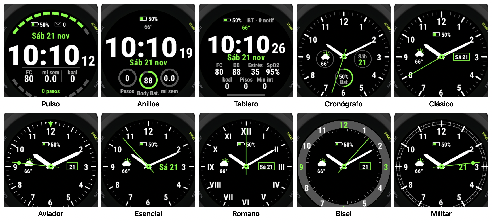
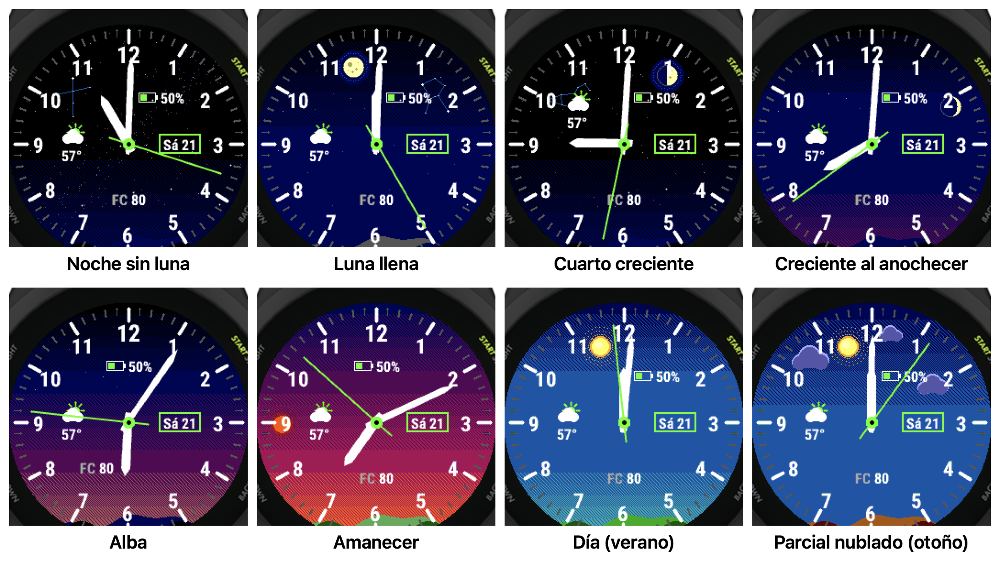
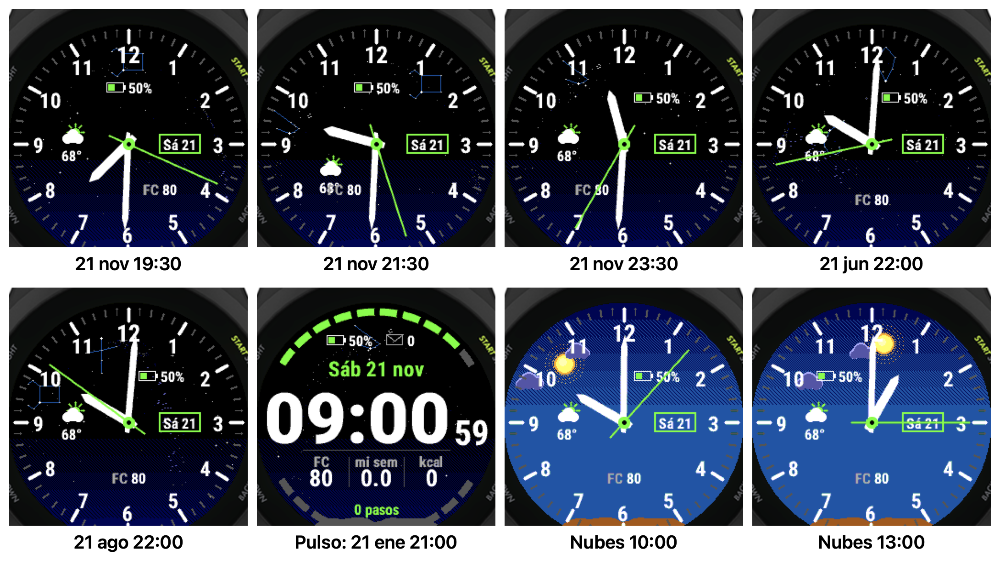

# Caratula Pro

Carátula (watch face) para **Garmin Forerunner 255**, hecha en Monkey C con el SDK de Connect IQ.
Tiene 10 estilos digitales y analógicos y 20 colores de acento. Se configura con un menú dentro del propio reloj.
También tiene un **cielo dinámico** sincronizado con la realidad: hora, ubicación, fase lunar, estrellas que giran, estaciones y clima.



## Qué incluye

- **10 estilos:** 3 digitales (Pulso, Anillos, Tablero) y 7 analógicos (Cronógrafo, Clásico, Aviador, Esencial, Romano, Bisel, Militar).
- **Datos:**
  - Batería del reloj, fecha, clima y temperatura.
  - Ritmo cardiaco, Body Battery, pasos, calorías, estrés, SpO2, pisos y minutos de intensidad.
  - Distancia corrida en la semana, notificaciones, amanecer y atardecer.
- **Analógicas inteligentes:** batería arriba, fecha a la derecha, clima a la izquierda y un dato extra abajo. Los 12 números siempre se ven, y si una manecilla tapa un dato, ese dato se recorre por el círculo.
- **Segundos:** al levantar la muñeca, nunca, o siempre (con repintado parcial de bajo consumo).
- **Idioma y unidades:** español o inglés, °C/°F, km/mi y 12/24 h. Cada uno tiene una opción "automático" que sigue la configuración del reloj.
- **Fondos:**
  - Negro o azul marino.
  - 9 texturas: degradados, fibra de carbono, rayos, panal, guilloché, topográfico, radar y camuflaje.
  - **Cielo dinámico**, con y sin clima.

### Cielo dinámico



- **Color del cielo** según la hora real de amanecer, atardecer y crepúsculos, calculados en el reloj con la fórmula solar de la NOAA para tu ubicación.
- **Sol y luna** que cruzan el cielo de este a oeste. La luna usa su fase real y sale y se pone según esa fase, así que hay noches sin luna.
- **Estrellas reales:** el cielo gira con el tiempo sidéreo local. Aparecen las constelaciones que de verdad están sobre ti en ese momento, y la Vía Láctea en el plano real de la galaxia cuando no hay luna.
- **Clima mínimo** (opcional): nubecitas que cambian cada día y avanzan con el viento real, con lluvia o nieve cayendo debajo de ellas y relámpagos cuando hay tormenta.
- **Horizonte** con colinas del color de la estación del año.



## Inicio rápido

```bash
# 1. Compilar e instalar en el reloj conectado por USB (macOS)
tools/install.sh
```

En el reloj: mantén presionado **UP** → **Carátula** → **Caratula Pro**. Para ajustarla: **Personalizar**.

Los requisitos, la llave de firma, el simulador, Windows y Linux, y la solución de problemas están en
**[docs/DESPLIEGUE.md](docs/DESPLIEGUE.md)**.

## Documentación

| Documento | Contenido |
|---|---|
| [docs/FUNCIONAMIENTO.md](docs/FUNCIONAMIENTO.md) | Arquitectura, cómo se dibuja cada estilo, datos, ajustes y cielo dinámico |
| [docs/DESPLIEGUE.md](docs/DESPLIEGUE.md) | SDK, llave de firma, compilación, simulador, instalación y problemas comunes |
| [AGENTS.md](AGENTS.md) | Instrucciones para agentes de código (Claude Code, Codex, etc.) |

## Estructura

```
manifest.xml            Aplicación (tipo watchface), producto fr255, permisos, idiomas
monkey.jungle           Configuración de compilación
source/
  CaratulaProApp.mc     App: vista inicial, menú de ajustes, aviso de presupuesto de energía
  CaratulaProView.mc    Dibujo de los 10 estilos, segundos, ajustes y fondos
  FaceData.mc           Lectura de sensores, clima, ubicación y viento
  Sky.mc                Cielo dinámico (sol, luna, estrellas, constelaciones, clima)
  SettingsMenu.mc       Menú "Personalizar" dentro del reloj
  Preview.mc            Constantes para vistas previas en el simulador (siempre -1 al publicar)
resources/              Textos en inglés (por defecto), ajustes, ícono y fondos
resources-spa/          Textos en español
tools/                  Instalación por USB, vistas previas y generador de fondos
capturas/               Capturas del simulador
docs/                   Documentación
```
